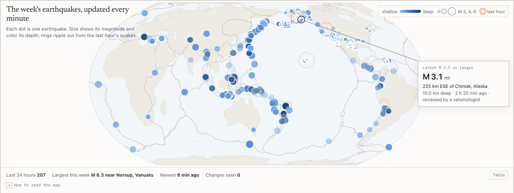

# live-earthquake-statistics

The past week of earthquakes from the US Geological Survey, refreshed every minute and analyzed in the browser. The page tests the classic law of how much rarer big quakes are, fits how aftershocks fade, and logs every time the catalog corrects itself while you watch.

**Live:** [tanaypratapsingh.github.io/live/quakes.html](https://tanaypratapsingh.github.io/live/quakes.html)

<picture>
  <source media="(prefers-color-scheme: dark)" srcset="docs/screenshot-dark.jpg">
  
</picture>

An earthquake catalog keeps changing after the fact. Automatic solutions get reviewed, magnitudes move, events merge under a new id, and a few are deleted. Every statistic computed from a live feed inherits those changes, so this page does two jobs at once: it computes the classic statistics of seismology, and it keeps a log of everything the catalog revised while the page was open.

## What it measures

| Card | Method |
| --- | --- |
| How much rarer is each bigger quake? | Gutenberg-Richter b-value by maximum likelihood (Aki 1965, Utsu's binning correction), Shi and Bolt (1982) uncertainty, and a 200 resample bootstrap that re-estimates completeness each time |
| Smallest size fully recorded | Magnitude of completeness by maximum curvature plus the 0.2 correction of Woessner and Wiemer (2005) |
| How fast do aftershocks fade? | Gardner-Knopoff windows around the mainshock with the most aftershocks, then an Omori-Utsu fit by maximum likelihood (Ogata 1983) with a profile likelihood range on p; below 30 aftershocks it draws the sequence without a fit |
| Which hours were unusual? | Each hour against a Poisson rate from the previous day, flagged below a tail probability of 0.001 |
| What the catalog changed while you watched | Every merge compares each event's `updated` time and logs magnitude, depth, location, status and preferred id changes, plus deletions |

A region selector (all events, global M4.5+, California, Alaska, Hawaii, Puerto Rico) scopes the map, every card and every fit. Explosions, quarry blasts and ice quakes are left out of every statistic.

## Measured on real data

The week feed fetched at 19:09 UTC on October 8, 2026 held 1,949 events. The logs are in [`runs/`](runs/).

| Region | Earthquakes | Completeness | Above it | b | 95% bootstrap |
| --- | --- | --- | --- | --- | --- |
| All events | 1,905 | 2.0 | 511 | 0.343 +- 0.013 | [0.317, 0.403] |
| Global M4.5+ | 120 | 4.8 | 62 | 1.496 +- 0.195 | [1.156, 2.041] |
| California | 610 | 0.9 | 370 | 0.727 +- 0.033 | [0.661, 0.851] |
| Alaska | 594 | 1.9 | 183 | 0.717 +- 0.050 | [0.609, 0.843] |
| Hawaii | 120 | 2.0 | 34 | too few above completeness (needs 50) | |
| Puerto Rico | 39 | | | too few events (needs 50) | |

The pooled b of 0.34 says more about mixing magnitude scales and networks (ml 51%, mb 29%, md 15%, mww 4% above completeness) than about the Earth, and the page says so beside the number. No sequence that week reached 30 aftershocks, so there was no Omori fit on live data.

Polling for 45 minutes from 19:19 UTC recorded 9 new events and 7 revisions, with no deletions. Six magnitudes changed, by 0.19 on average. One event changed its preferred id from the Alaska network's solution to the USGS national one, which the merge logs as a revision instead of a deletion plus a new event.

## A test that failed for the right reason

The first b-value test failed: its synthetic catalog had a true b of 1, and the 95% bootstrap interval came out [1.015, 1.070]. A 95% interval should miss about one time in twenty. Across 300 synthetic catalogs it covered the true value 93.7% of the time, with a spread of 0.0183 against a mean Shi and Bolt uncertainty of 0.0176. The single catalog test now uses a different seed, and a separate test requires at least 16 of 20 catalogs to cover the true value. For the Omori exponent, the spread of the fitted p is 0.211 with 120 aftershocks and 0.065 with 1,000.

## Run it

```bash
python3 -m http.server 8000
```

Then open `http://localhost:8000`. ES modules do not load from `file://`. The map loads d3-geo, topojson-client and the Natural Earth land outlines from jsDelivr, pinned to exact versions; every number is still computed if the CDN fails.

## Tests

```bash
node --test tests/*.test.mjs
```

27 tests on node 22 or newer, nothing to install. They recover b = 1 and a known completeness magnitude from synthetic catalogs, check the Shi and Bolt formula, recover p = 1.1 and c = 0.05 from synthetic aftershock times, and cover the merge rules: revisions, deletions, events aging out, stale responses, preferred id changes and events that come back. The two calibration checks quoted above run on their own:

```bash
node tests/sim/quakes_b_coverage.mjs
node tests/sim/quakes_omori_spread.mjs
```

## Layout

```
index.html         the page
quakes/seismo.js   merging, completeness, b-value, bootstrap, windows, Omori and the Poisson rule: pure, no DOM
quakes/app.js      polling, the map, ripples and charts
assets/            shared styles, helpers, charts and the paint scheduler
tests/             node:test suite, plus sim/ calibration scripts
runs/              logs of the runs quoted above
docs/              screenshots
```

## Limitations

- The feed mixes ml, md, mb and moment magnitudes from many networks, so pooled b-values are not physical estimates.
- One week is short: aftershock fits need a sizeable mainshock inside the region, which most weeks do not have.
- No deletion happened in 55 minutes of polling, so the deletion logic has only been exercised on synthetic feeds.
- The 1:110 million coastlines are rough for Hawaii and Puerto Rico.

## Data

U.S. Geological Survey earthquake summary feeds, public domain. Plate boundaries from [fraxen/tectonicplates](https://github.com/fraxen/tectonicplates), ODC-BY 1.0, after Bird (2003); credit Hugo Ahlenius, Nordpil and Peter Bird.

Part of the [live data dashboards](https://tanaypratapsingh.github.io/live/) on my portfolio. MIT licensed.
